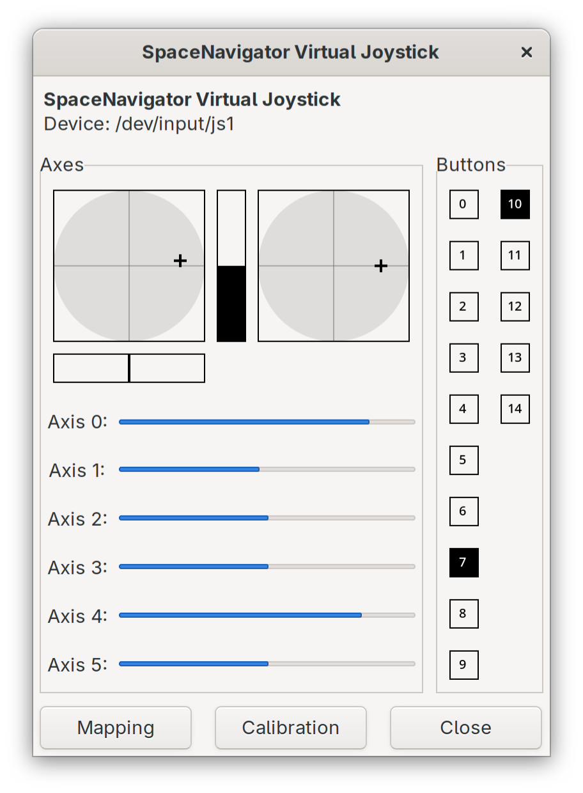

# spnavjoy

Bridges a 3Dconnexion SpaceNavigator from [spacenavd](https://github.com/FreeSpacenav/libspnav) to a Linux uinput virtual joystick.

`spnavjoy` connects to `/run/spnav.sock`, reads motion and button events, and writes them to `/dev/uinput` as a generic 6-axis joystick named `SpaceNavigator Virtual Joystick`. The device is created on connect/hotplug and destroyed on removal.

## Mapping

Motion events map to six ABS axes; buttons map to `BTN_JOYSTICK + n`.

Input              | spnav event   | uinput
-------------------|---------------|----------------------
Translate X        | `motion.x`    | `ABS_X`
Translate Z        | `motion.z`    | `ABS_Y`
Translate Y        | `motion.y`    | `ABS_RX`
Tilt forward/back  | `motion.rx`   | `ABS_RZ`
Rotate             | `motion.ry`   | `ABS_Z`
Tilt left/right    | `motion.rz`   | `ABS_RY`
Button `n`         | `button.bnum` | `BTN_JOYSTICK + n`

The mapping is hardcoded in `spnavjoy.cpp`, including the axis range (-350..350, flat 15). Those limits were arrived at experimentally to cover the device's full output range.

The mapping was created based on it feeling just about right and making it easy to map in games and other 3D apps. Making it configurable would be a reasonable future change.

Best I can tell, SpaceNav only has devices with 6 axes, so no accomodations were made otherwise. A diverging axis count is likely to result in unintended behaviour.

## Dependencies

- libspnav (headers and library)
- spacenavd running, socket at `/run/spnav.sock`
- Linux uinput
- write access to `/dev/uinput` (root, `input` group, or a udev rule)

## Build

    make

Produces `./spnavjoy`.

## Run

    ./spnavjoy

## Install

    make install
    systemctl --user daemon-reload
    systemctl --user enable --now spnavjoy.service

`make install` puts the binary in `~/.local/bin/spnavjoy` and the unit in `~/.config/systemd/user/spnavjoy.service`. Override `PREFIX` or `UNITDIR` if needed; the unit assumes the default prefix (`ExecStart=%h/.local/bin/spnavjoy`).

The unit waits for `/run/spnav.sock` via `ExecStartPre` and restarts on failure. The user service needs write access to `/dev/uinput`.

## Controlling the service

    systemctl --user status spnavjoy.service
    systemctl --user start spnavjoy.service
    systemctl --user stop spnavjoy.service

Logs go to the user journal:

    journalctl --user -u spnavjoy.service -f

The systemd unit is an optional convenience. To run the binary directly:

    ./spnavjoy

## Limitations

- The spnav API exposes only one device, so only one 3Dconnexion controller is supported per machine.
- `spnavjoy` re-creates the uinput device when the reported button or axis count changes (e.g. on hotplug). Consumers holding the old `/dev/input/jsN` fd must reopen it.

## Uninstalling

Manually remove the binary and unit file, then reload systemd:

    systemctl --user disable spnavjoy.service
    rm ~/.local/bin/spnavjoy
    rm ~/.config/systemd/user/spnavjoy.service
    systemctl --user daemon-reload
